# Dian Brown

<picture>
  <source media="(prefers-color-scheme: dark)" srcset="assets/commitcade/ufo-contribution-graph-dark.svg">
  <source media="(prefers-color-scheme: light)" srcset="assets/commitcade/ufo-contribution-graph.svg">
  
</picture>

Design engineer based in South Africa. I build websites and interactive software, bringing together clear interfaces, expressive motion, and real-time 3D.

I'm currently pursuing an MSc in Computer Science at North-West University, continuing my [research into classroom attendance using UHF RFID](https://dianbrown.com/projects/uhf-attendance). My background spans Information Technology and Occupational Health Sciences.

[Portfolio](https://dianbrown.com) · [Creative lab](https://dianbrown.com/lab) · [LinkedIn](https://linkedin.com/in/dian-brown-db01)

## Selected work

- **[Camellia Collection](https://dianbrown.com/projects/camellia-collection)** — An Astro and React storefront with custom motion, shader effects, authentication, and secure checkout.
- **[Draf Dag](https://dianbrown.com/projects/draf-dag)** — A charity fun-run campaign website built with Astro, GSAP, and animated SVGs.
- **[Save a Slot](https://dianbrown.com/projects/save-a-slot)** — A local-first React Native app for appointments, clients, and small-business management.
- **[Rocky](https://dianbrown.com/projects/rocky)** — An output-compression skill for AI coding agents, backed by a reproducible Python benchmark.

[More projects](https://dianbrown.com/projects)

## Tech stack

### Web and mobile

### Motion and 3D

### Backend and data

### Interface design

